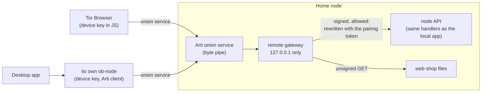

# Home node

Run your store on an always-on computer at home (a Mac mini, a Linux box, a
Raspberry Pi, a NAS with Docker) and manage it from your phone or laptop
anywhere: listings, store profile, orders, wallet balance and receive
addresses, node status. There is no account, no OpenBazaar server, and no
relay. The node is reached only as a Tor onion service, and every device signs
every request with its own key.

Code: `crates/node/src/remote/` (gateway, pairing, devices, client mode),
`crates/tormail/src/forward.rs` (onion service forward and dial),
`apps/mobile/src/homeNode/` (browser signing and transport),
`apps/mobile/src/marketplace/HomeNodePanel.tsx` and `HomeNodeGate.tsx` (UI).
Tests: `crates/node/src/remote/tests.rs`, unit tests beside each module,
`apps/mobile/src/homeNode/signing.test.ts`.

## Set it up

The node runs on testnet4 only (test coins). Pick one:

**Linux (systemd).** Unpack `ob-node_<version>_linux-x86_64.tar.gz` (or
`linux-arm64` for a Raspberry Pi 4/5) and follow the comments at the top of
`ob-node.service`. The vault passphrase goes in `/etc/openbazaar/ob-node.env`
(mode 600).

**Docker.** `packaging/docker/compose.yml` runs `ghcr.io/openbazaar/ob-node`.
Put `OB_VAULT_PASSPHRASE=...` in `.env` next to it and run
`docker compose up -d`. No port is published.

**macOS.** Unpack `ob-node_<version>_macos-universal.tar.gz` and follow the
comments in `app.openbazaar.home-node.plist`. It runs as a launch agent of the
logged-in user, so the vault key lives in that user's Keychain; turn on
automatic login if the Mac must come back after a power cut.

**From source.** `cargo build --release -p ob-node`, `npm run build` in
`apps/mobile`, then
`ob-node serve --remote --web-dir apps/mobile/dist --data-dir DIR --vault passphrase`.

### First run

On first start the node creates its onion service (Arti, in `tor/` inside the
data dir; the address stays the same across restarts) and, while no device is
paired, prints a pairing code and a QR code of it to its console, the journal
(`journalctl -u ob-node`), the launchd log, or `docker compose logs`:

```
ob-node: remote access at http://5gyx6c…ttfad.onion/
ob-node: No device is paired yet. Pair your first device with this code (one use, valid 15 minutes):

    obhome:szyn3ggfglgornlvvhyxo64tgj6wjdhc@5gyx6c…ttfad.onion
```

Make another code any time with `ob-node pair --data-dir DIR` on the node
(it asks the running node over loopback), or under **Settings → Home node →
Pair a new device** on a device that is already paired. The onion service
needs up to a minute or two after start before it can be reached.

### Connect a device

- **The desktop app.** Settings → Home node → paste the code, name the
  device, Connect. Then **Manage home node** switches the whole app to the
  home node; the blue banner says so and **Use this computer's node** switches
  back. The app's own node holds the device key (sealed in `home-node.obv`) and
  dials the onion with its built-in Arti.
- **A phone or another laptop.** Open the onion address in Tor Browser
  (Android, desktop) or Onion Browser (iOS) and paste the code. The page is the
  same shop, served by the node. The browser makes its own device key and
  shows it once as an **access key** (`obkey-…`). Tor Browser forgets site data
  when it closes, so save the access key in a password manager and paste it to
  sign in next time; **Remember on this browser** keeps it in the browser's
  storage instead. The shop needs JavaScript: use the Standard or Safer
  security level.

Every paired device is listed under Settings → Home node with when it was
paired, by which device, and when it was last seen. **Remove** cuts a device
off at once.

## Design



- **Onion service, not a server.** The node publishes an onion service with
  Arti. It forwards each stream to a gateway listener on `127.0.0.1`. Nobody
  learns where the node is, the node never opens a port on the router, and the
  connection is end-to-end encrypted and authenticated to the onion key (the
  address *is* the key). The gateway refuses to bind anything but loopback.
- **Keys, not accounts.** Each device has a BIP 340 key. Pairing proves the
  device holds it and spends a one-time code; afterwards every request is
  signed and carries a fresh nonce and the time. The node keeps the device
  list sealed in the vault (`remote-devices.obv`, with a random node id that
  every signature commits to).
- **One API.** An accepted request is rewritten into an ordinary loopback
  request carrying the node's pairing token and handed to the same router the
  local app uses, one request at a time. There is no second, remote-only API
  to drift from the real one.
- **Policy on top.** A device session cannot do what only the machine's owner
  at the machine should do (below), and spending is guarded exactly as it is
  locally: the wallet passphrase for each spend ticket.

### Pairing

A code is `obhome:{secret}@{address}`: 160 random bits (32 base32 letters) and
the onion address to dial. A code works once and for 15 minutes; at most four
are live. After 20 wrong secrets in 10 minutes pairing pauses for the rest of
that window. The device sends `POST /remote/pair` with
`{secret, publicKey, name, signature}`, where the signature is over
SHA-256 of `OBPAIR1\n{secret}\n{publicKey}\n{name}`; a bad proof does not use
up the code. The answer gives the device id and the node id. At most 32
devices; names are 1 to 40 characters.

### Signed requests

| header | value |
|---|---|
| `X-Ob-Device` | device id: first 16 hex digits of SHA-256 of the x-only key |
| `X-Ob-Time` | unix seconds |
| `X-Ob-Nonce` | 32 random hex digits |
| `X-Ob-Signature` | BIP 340 over SHA-256 of `OBRQ1\n{nodeId}\n{deviceId}\n{time}\n{nonce}\n{METHOD}\n{path}\n{sha256(body) hex}` |

The node takes a time within 120 s of its clock and not before it started,
and each nonce once per device (nonces are kept for 240 s, 4096 per device;
a restart forgets them, which is why times before the restart are refused).
A `401` with `code: "clock"` carries `serverTime` so the client can correct its
offset and retry once. Refusals: `401 unsigned`, `unknown_device`, `replay`,
`clock`; `403 node_only` for the policy below. The gateway also checks `Host`
(the onion name) and `Origin` (`http://{onion}`), and serves the web shop's
files to unsigned `GET`s with a strict CSP (`script-src 'self'`,
`connect-src 'self'`, no framing).

### What a device cannot do

| Refused to devices (`403 node_only`) | Why |
|---|---|
| `POST /wallet/phrase` (reveal the backup phrase) | A device session must never export the seed. |
| `POST /escrow/mail` | Moderator and escrow mail keys stay with the node. |
| `/unlock` with `remembered: true`, `PUT /lock/settings` with `rememberDevice: true` | "Remember this device" is a property of the machine's keystore, not of a phone. |
| `/pair`, `/home*` | The local pairing code and the node's own client mode. |

Everything else a local client can do, a device can do, including
`POST /setup`: a headless node has no other screen to create its wallet
on, so the first paired device does it, and the new backup phrase is shown on
that device once (over the onion service). Spending needs the wallet unlocked
**and** a one-time spend ticket from `POST /spend-tickets`, which needs the
wallet passphrase every time. The lock is the node's, not the device's: an
unlock from any device unlocks the node, and auto-lock applies to all.

### Revocation

`DELETE /remote/devices/{id}` (from the node's own app, or from any paired
device) removes the device and, transitively, every device it paired, closes
its pairing codes, and forgets its nonces. Its next request gets
`401 unknown_device`. **Forget home node** in the desktop app asks the home
node to remove this device first, then deletes the local key.

## Threat model

Protects against:

- **Finding the store owner.** The node is an onion service: no IP address,
  no DNS, no port on the router, no account, nothing at OpenBazaar to
  subpoena. Devices also use Tor, so the node does not learn where they are.
- **A network attacker** (Wi-Fi, ISP, a compromised router). Traffic is inside
  Tor, end-to-end to the onion key. There is no plain-HTTP or LAN path to
  intercept.
- **Someone who knows the onion address.** They can load the shop's static
  files and `/remote/hello` (`{service, nodeId}`), and that is all. Every API
  call needs a paired device key. Guessing a pairing code is 160 bits against
  at most four live codes and 20 tries per 10 minutes.
- **Replay and tampering.** A captured request (from a log, a proxy, a
  debugging session) cannot be sent again or changed: signatures cover method,
  path, body, node, device, nonce, and time.
- **A stolen or lost phone.** Remove it from any other device or the node;
  anything it paired goes with it. Until then the thief can browse and edit the
  store if the phone and browser are unlocked and the key is there, but cannot
  spend without the wallet passphrase, cannot read the backup phrase, and
  cannot pair more devices that survive the phone's removal.

Does not protect against:

- **A compromised browser or device.** Malware or a malicious extension in the
  browser that holds the key can act as that device until it is removed, and
  can read the wallet passphrase if you type it there. Use a browser you trust
  (Tor Browser without extensions), and prefer not to keep the access key in
  browser storage on a shared machine.
- **The onion address leaking.** It does not locate you, but it tells someone
  the service exists and lets them try the pairing endpoint and load the shop
  files. It cannot be changed from the UI today; to rotate it, stop the node,
  delete `tor/` in the data dir, and restart. Paired keys stay valid: browsers
  sign in at the new address with their access key, and the desktop app must
  forget the home node and pair again, because it stored the old address.
  Restricted discovery (Tor client authorization) would hide the service from
  anyone without a client key; see Future work.
- **Pairing codes in logs.** The first-run code goes to the service log.
  It works once and for 15 minutes, so a log read later is harmless; a log
  read within that window by someone who can also reach the onion is not.
  `ob-node pair` prints to the terminal only.
- **Someone with the node machine.** The node's own disk and OS account are
  the root of trust, as for the local app: they hold the vault (sealed under
  the OS keystore or the vault passphrase) and the device list. See
  [wallet-lock.md](wallet-lock.md) for what the wallet lock adds.
- **A lost pairing answer.** If the connection drops after the node accepted a
  device but before the device saw the answer, the node lists a device that
  holds no key anywhere. Remove it; it can do nothing.
- **Traffic analysis of Tor itself**, and a global adversary watching both the
  home connection and the device. The node's other traffic (rates, chain
  peers) is not on Tor unless `--proxy` is set; see STATUS.md.

## Tradeoffs and alternatives

- **LAN direct access: not offered.** A browser cannot pin a self-signed key
  for a LAN address, and plain HTTP on the LAN is open to anyone on the
  network. The gateway therefore never binds a non-loopback address. A future
  native app could pin the node's key and talk to it on the LAN; the request
  signatures already make that safe to add without new auth.
- **No relay, no push.** There is no OpenBazaar relay or push service, so a
  device learns of new orders only when it looks. A relay would make the node
  reachable faster and could push notifications, but it is a central party
  that learns who talks to whom. It was left out per the project's principles;
  adding an optional, self-hostable one is a product decision.
- **Tor latency.** The first connection takes seconds to build a circuit
  (pairing took about 8 s in a live run; later calls about 1 s, a listing
  edit about 5 s). The onion service needs a minute or two after the node
  starts.
- **Browser storage.** Tor Browser forgets storage, so phones in Tor Browser
  sign in with an access key each session. A native app with Arti built in
  could keep the key in the OS keystore; that app does not exist yet.

## Future work

- Restricted discovery: give each device a Tor client-authorization key so the
  onion service is invisible without one.
- Arti's onion service proof-of-work against denial of service.
- A native mobile client with embedded Arti, keystore-held keys, and QR
  scanning (the node already prints a QR of the code).
- Rotating the onion address from the UI.
- Per-device scopes (for example, a device that can fulfil orders but not
  edit listings).

## Testing

`cargo test -p ob-node --lib remote::` covers pairing (once only, bad proof
does not burn the code, pause after guessing), signed requests (unsigned,
tampered, other node, unknown device), replay, stale and pre-restart times,
cascading revocation and self-removal, the device list surviving a restart
sealed, the policy, the spend-ticket requirement (a device cannot pay without
the passphrase and a ticket, and a ticket pays once), gateway host and origin
checks, the static shop files, and a two-node end-to-end run over loopback in
which a paired client node lists the home node's catalog, relabels a listing
so the home node re-signs it, reads `/version`, is revoked, and is refused.
`signing.test.ts` checks the browser's keys and digests against the same
vector as the Rust tests.

A live run over Tor (two nodes on one machine, real onion service): pairing
in 7.7 s, `/version` in 0.95 s, a listing relabel in 5.1 s that changed the
home node's catalog, `/wallet/phrase` refused with `node_only`, and the device
refused with `unknown_device` after removal.
