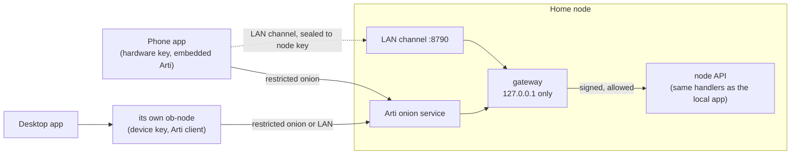

# Home node

Run your store on an always-on computer at home (a Mac mini, a Linux box, a
Raspberry Pi, a NAS with Docker) and manage it from your phone or laptop
anywhere: listings, store profile, orders, wallet balance and receive
addresses, node status. There is no account, no OpenBazaar server, and no
relay. Away from home the node is reached only as a Tor onion service that
only your paired devices can find; at home, devices may use an encrypted LAN
channel instead. Every device signs every request with its own key.

The wire format is in [home-node-protocol.md](home-node-protocol.md). Code:
`crates/node/src/remote/` (node and client), `crates/tormail/src/forward.rs`
(Arti onion services), `apps/mobile/src/homeNode/` and `apps/mobile/src/native/`
(the app), `apps/desktop/src-tauri/src/node.rs` (desktop home mode).

## Set it up

The node runs on testnet4 only (test coins). Pick one:

**The desktop app.** Settings → Home node → **Run this computer as a home
node**. The app restarts its own node with remote access on. It serves only
while the app is open; for a machine that must stay on, use a service below.

**Linux (systemd).** Unpack `ob-node_<version>_linux-x86_64.tar.gz` (or
`linux-arm64` for a Raspberry Pi 4/5) and follow the comments at the top of
`ob-node.service`. The vault passphrase goes in `/etc/openbazaar/ob-node.env`
(mode 600).

**Docker.** `packaging/docker/compose.yml` runs `ghcr.io/openbazaar/ob-node`.
Put `OB_VAULT_PASSPHRASE=...` in `.env` next to it and run
`docker compose up -d`. No port is published and the node is Tor-only; on a
Linux host, the commented `network_mode: host` lines add the LAN channel and
the setup page (Docker's bridge network does not carry mDNS).

**macOS.** Unpack `ob-node_<version>_macos-universal.tar.gz` and follow the
comments in `app.openbazaar.home-node.plist`. It runs as a launch agent of the
logged-in user, so the vault key lives in that user's Keychain; turn on
automatic login if the Mac must come back after a power cut.

**One command, from source.** `cargo build --release -p ob-node`, then
`ob-node serve --remote --lan --data-dir DIR --vault passphrase`
(add `--web-dir apps/mobile/dist` to serve the web shop to Tor Browser).

`--remote` publishes the onion service. `--lan` opens port 8790 on the home
network for the encrypted LAN channel, mDNS (`openbazaar.local`), and the
setup page. `--push-gateway http://….onion` turns on push wake-ups (below).

## Pair a device

While no device is paired, the node shows a pairing code in three places:

- the **setup page**, `http://openbazaar.local:8790/` from any device on the
  home network (with `--lan`): a QR code, the eight words, and Approve/Reject
  buttons for waiting devices;
- the **console**, when the node runs in a terminal: the words, the link, and
  the QR drawn in text. When its output is not a terminal (systemd, launchd,
  Docker), the node makes no code at startup and the service log says to run
  `ob-node pair` instead;
- `ob-node pair --data-dir DIR` in a terminal on the node, which also asks
  you to approve the device there. `--lan-page` puts the setup page up again
  for 10 minutes.

A paired device can make more codes (Settings → Home node → Pair a new
device). A code works once and for 10 minutes.

On the new device choose **Connect to my home node** and scan the QR or type
the eight words. Words are enough from anywhere: they derive the onion address
of a short-lived pairing service. Then both screens show **four emoji**.
Approve on the node (setup page, console, the node's own app, or an
already-paired device) only if they match. The device then holds:

- its **device key**, made on the device (Secure Enclave on iPhone, StrongBox
  or the TEE on Android, the desktop node's vault for the desktop app), which
  signs every request;
- its **discovery key**, a Tor client-authorization key it made itself, which
  the node adds to its onion service's list so this device can find it;
- the node's public key, pinned for the LAN channel.

**Tor Browser** (secondary). A paired device can make a browser credential:
a discovery secret to type into Tor Browser's onion-authentication prompt and
an access key (`obkey-…`) for the shop page the node serves. Tor Browser
forgets both when it closes unless you save them.

## Devices, removal, recovery

Settings → Home node lists every device with its platform, who paired it,
when it was last seen and over what (`tor`, `lan`), and whether push is on.
On the node, `ob-node devices --data-dir DIR` prints the same list.

- **Remove** cuts the device off at once (its next request is `401
  unknown_device`), together with every device it paired, and takes its
  discovery key off the onion service.
- **Remove and change address** also moves the node to a new onion address.
  Remaining devices learn the new address on their next request
  (`X-Ob-Next-Onion`) and switch; the old address is retired when all of them
  have moved, or after 7 days. Use it when a device was stolen: Tor does not
  promise that a removed client forgets the service's introduction points.
- **Lost every device:** on the node, `ob-node devices --remove-all --rotate`,
  then pair again from the setup page or `ob-node pair`.

## Design

- **Onion service, not a server.** Nobody learns where the node is, it never
  opens a port on the router, and the connection is end-to-end encrypted and
  authenticated to the onion key. The admin service uses restricted discovery,
  so without a paired device's discovery key the address does not resolve at
  all: no shop, no endpoints, nothing to probe.
- **Keys, not accounts.** Each device has its own key; pairing proves it holds
  the key and the one-time secret, and the owner confirms the emoji on the
  node. After that, each request carries a fresh nonce, the time, and a
  signature over the node, the device, the method, the full target, and the
  body hash.
- **One API.** An accepted request is handed to the same router the local app
  uses, under a policy for what devices may not do. There is no second API to
  drift from the real one.
- **Fast without giving anything up.** The app keeps an encrypted replica of
  catalog, orders, wallet and status and shows it at once ("Connecting
  privately…"). `POST /remote/sync` sends only what changed by etag;
  edits made offline queue up and go in one `POST /remote/batch`, which the
  node runs once even if the answer is lost. At home the app finds the node by
  mDNS and talks to it directly in a few milliseconds; elsewhere Tor takes a
  few seconds.

### Security layers

1. **Restricted discovery.** Only devices with a discovery key can find the
   onion service.
2. **Signed requests.** Only devices on the node's list can call it, and no
   request can be replayed or altered.
3. **Passphrase and spend ticket.** Spending needs the wallet unlocked and a
   one-time spend ticket from `POST /spend-tickets`, which needs the wallet
   passphrase every time. A device session alone can never spend.
4. **App lock.** The app asks for Face ID, Touch ID, or the fingerprint before
   it opens, and the device key itself requires user presence to sign. A
   separate watch key, which can only sync, lets the app refresh in the
   background without unlocking.

### What a device cannot do

| Refused to devices (`403 node_only`) | Why |
|---|---|
| `POST /wallet/phrase` (reveal the backup phrase) | A device session must never export the seed. |
| `POST /escrow/mail` | Moderator and escrow mail keys stay with the node. |
| `/unlock` with `remembered: true`, `PUT /lock/settings` with `rememberDevice: true` | "Remember this device" is a property of the machine's keystore, not of a phone. |
| `/pair`, `/home*`, `POST /remote/lan-page` | The local pairing code, the node's own client mode, and the setup page are for the machine itself. |

Everything else a local client can do, a device can do, including
`POST /setup`: a headless node has no other screen to create its wallet on,
so the first paired device does it and sees the new backup phrase once.

## Threat model

Protects against:

- **Finding the store owner.** No IP address, no DNS, no port on the router,
  no account, nothing at OpenBazaar to subpoena. Devices also use Tor, so the
  node does not learn where they are. mDNS on the home network names a random
  instance and no node id.
- **A network attacker** (Wi-Fi, ISP, a compromised router). Away from home,
  traffic is inside Tor, end-to-end to the onion key. On the LAN, every
  request and answer is sealed to the node key the device pinned at pairing;
  only the setup page is plaintext, and it holds nothing once a device is
  paired.
- **Someone who learns the onion address.** Without a discovery key they
  cannot find the service. Even with one, every call needs a paired device
  key.
- **A person in the middle during pairing.** The emoji are a hash of the
  secret, the node key, and the device's keys; a substituted key changes them,
  and the owner must approve on the node. Guessing a code is 80 bits against
  at most four live codes and 20 bad proofs per 10 minutes.
- **Replay and tampering.** Signatures cover the method, target, query, body,
  node, device, nonce, and time; nonces are accepted once.
- **A stolen or lost phone.** The device key needs the owner's biometrics or
  passcode, the wallet needs the passphrase for every spend, and the seed
  cannot be read. Remove the phone (and change the address) from any other
  device or the node.

Does not protect against:

- **A compromised device.** Malware on an unlocked phone or in Tor Browser
  can act as that device until it is removed, and can read the wallet
  passphrase if you type it there.
- **Someone with the node machine.** Its disk and OS account are the root of
  trust, as for the local app: they hold the vault (sealed under the OS
  keystore or the vault passphrase) and the device list. See
  [wallet-lock.md](wallet-lock.md).
- **Someone on the home network during setup.** Before the first device is
  paired, anyone on the LAN can open the setup page, read the code, and
  approve their own device, the same as someone at the node's console. Pair
  right after first start, or run without `--lan` and pair from the console.
  After the first pairing the page shows only a code when you ask for one
  (`--lan-page`), and approval needs the node or a paired device.
- **Pairing codes on a terminal.** The first-run code and `ob-node pair` show
  a code to whoever can read that terminal. It works once and for 10 minutes,
  and a request made with it still needs your approval on the node. A service
  log gets no code: with no terminal the node makes none at startup, and you
  run `ob-node pair --data-dir DIR` for one. The node's pairing token is never
  printed, only the path of its file (`pairing.token` under the data dir).
- **Pairing denial of service.** Anyone who can reach a pairing service (the
  LAN, or someone who saw the words) can send bad proofs and pause pairing for
  the rest of a 10-minute window. Paired devices are unaffected.
- **Traffic analysis of Tor itself**, and a global adversary watching both the
  home connection and the device. The node's other traffic (rates, chain
  peers) is not on Tor unless `--proxy` is set; see [STATUS.md](STATUS.md).

## Push notifications and their privacy cost

Off by default, on each device separately. Without push, the app syncs when
it opens, and the Android app also checks over Tor in the background now and
then (WorkManager). iOS gives an app no reliable background time without
push.

With push on, the device gives the node an APNs or FCM token. When an order,
message, or payment arrives, the node waits 0 to 90 seconds and asks a **push
gateway** (`--push-gateway`, an onion address) to send a wake-up with no
content to that token, at most once per device every 10 minutes. The app wakes
and syncs over Tor or the LAN as usual.

What that reveals: Apple or Google learns that this phone got a wake-up from
the gateway's app at roughly that time, and the gateway operator learns the
token and the timing. Neither learns what happened, from which node, or
where the node is (the node reaches the gateway over Tor). Over time the
timing pattern says how busy the store is, and the token ties it to the phone's
Apple or Google account. That is the tradeoff; keep push off if it matters.

### Running a push gateway

The project does not run one, and the node has no default: without
`--push-gateway` nothing is ever sent. A gateway can only wake the app it
holds credentials for, so it is run by whoever publishes the app. It needs:

- **An onion service**, `http://….onion`, that accepts
  `POST /v1/wake` with `{"platform": "apns" | "fcm", "token": "…"}` and
  answers `202`. Nodes reach it only over Tor, so it never sees their
  addresses. It should keep no logs of tokens or timing, and rate-limit per
  token (the node already sends at most one wake-up per device per 10 minutes).
- **APNs:** an Apple Developer Program membership, an APNs auth key (`.p8`)
  with its key id and team id, and the app's bundle id
  (`app.openbazaar.mobile`). Send a background notification
  (`apns-push-type: background`, `content-available: 1`, no alert, no
  payload data) to `api.push.apple.com`.
- **FCM:** a Firebase project with the Android app registered, and a service
  account key for the FCM HTTP v1 API. Send a data-only, high-priority
  message with no notification block.
- The matching app build: the iOS app with the push entitlement and the
  Android app with that project's `google-services.json`. The app sends its
  token to the node only after the user turns push on.

Run a node against it with `ob-node serve --remote --push-gateway http://….onion`.

## Tradeoffs and alternatives

- **LAN fast path.** The LAN channel is direct and fast but announces on the
  home network that an OpenBazaar node exists (mDNS name, port 8790). Without
  `--lan` the node is Tor-only and pairing uses the console.
- **Tor latency.** Building circuits takes seconds. Measured with two nodes on
  one machine: pairing 16–22 s, later requests 4–8 s. Right after a device
  is approved, the onion service has to republish its descriptor with the new
  key; the client retries with a fresh descriptor, so the first request after
  pairing took up to 74 s. The app hides this behind its replica and queue.
- **Tor Browser.** Kept for computers without the app. It needs JavaScript
  (Standard or Safer level) and the user handles two secrets by hand.
- **No relay.** A relay would make the node reachable faster but is a central
  party that learns who talks to whom.

## Testing

`cargo test -p ob-node --lib remote::` covers:

- pairing: one use, expired and reused codes, bad proofs that do not burn the
  code, the pause after 20 bad proofs, the emoji changing when a key is
  substituted, approval adding the discovery key, cascading revocation taking
  it back;
- signed requests: unsigned, tampered (including an added query), wrong node,
  unknown device, replayed nonce, stale and pre-restart times;
- the policy, watch keys limited to sync, and a device session that cannot
  spend without the passphrase and a ticket (and a ticket that pays once);
- delta sync (only changed items, removals, documents), batches run once,
  push off until the device turns it on, the LAN channel's sealing, the setup
  page on first run only;
- a two-node run over the LAN channel on loopback in which a paired client
  node manages the home node;
- shared test vectors (`vectors.json`) checked by Rust and TypeScript.

Live runs over Tor (two or three nodes on one machine, real onion services):
pairing with the eight words over the derived pairing onion in 16–22 s, the
same four emoji on both sides, approval collected in 1 s, a device added while
the node was running reaching it on its first request (74 s, then 8 s),
removal answered with `unknown_device` within 6 s, and `--rotate` moving the
remaining device to the new address, after which the node retired the old one.
